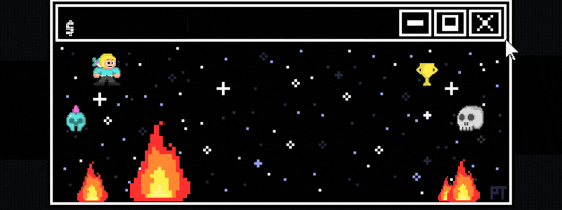
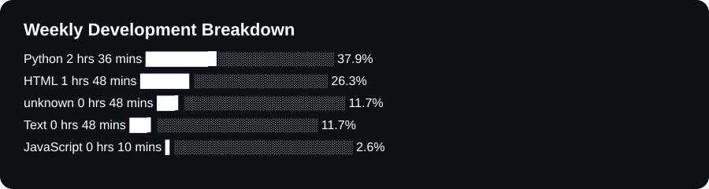

Bivour Devnath Ankur


<p align="center">
  
</p>


<p align="center">
   
</p>


<h1></h1><br>

<picture data-importer="pacman">
  <source media="(prefers-color-scheme: dark)" srcset="https://raw.githubusercontent.com/bhivourdevnath-stack/bhivourdevnath-stack/pacman-output/pacman-contribution-graph-dark.svg?game=pacman">
  <source media="(prefers-color-scheme: light)" srcset="https://raw.githubusercontent.com/bhivourdevnath-stack/bhivourdevnath-stack/pacman-output/pacman-contribution-graph.svg?game=pacman">
  
</picture>

```
Btw, my GitHub contribution graph is FAKE

I was just trying to print my name on it using AI,
but bro started cooking without a recipe and burned the whole kitchen

So yeah, don't mistake me for some pro coder just because my graph looks cool

I'm still learning, still breaking things, and still blaming AI for my crimes. 

tho I'M a larper
```
<hr>


<br>

<table>
<tr>
<td width="50%" valign="top">

### 🎨 Languages


</td>
<td width="50%" valign="top">

### ⚙️ Web and Back-End


</td>
</tr>

<tr>
<td width="50%" valign="top">

### 🗄️ Databases & Storage


<br/>

`SQL` · `File-based Storage` · `Pickle`

</td>
<td width="50%" valign="top">

### 🤖 AI & Automation


<br/>

`LLMs` · `AI APIs` . `AI Automation` · `Chatbots`

</td>
</tr>

<tr>
<td width="50%" valign="top">

### 🔌 Embedded Systems & IoT


<br/>

`Arduino IDE` · `Sensors` · `GPIO` · `IoT`

</td>
<td width="50%" valign="top">

### 🛠️ Tools & Development


</td>
</tr>

<tr>
<td width="50%" valign="top">

### ☁️ Deployment & Environment


<br/>

`uv` · `Virtual Environments` · `Environment Variables` · `.env`

</td>
<td width="50%" valign="top">

### 🔭 Currently Exploring


<br/>

`Full-Stack Development` · `Backend Systems` · `IoT`

</td>
</tr>
</table>


<h2 data-importer="text" align="left">Stats :</h2>

###

<div data-importer="stats" align="center">
  <table>
  <tr>
  <th></th>
 <th></th>
  </tr>
  <tr>
  <th colspan="2"></th>
  </tr>
  </table>
</div>

<hr>

## Collab with me and work together; let's build cool project

<p align="center">
  <a href="https://discord.com/users/1534800398706020463">
  
  </a>
</p>


<hr>


###

<h2 data-importer="text" align="left">Social media</h2>

###

<div data-importer="socials" align="left">
  
  
  
</div>

<hr>

<p align="center">
  
</p>

```bash

          "人は皆、猿のまがいもの
          神は皆、人のまがいもの"

 "All people are but imitations of monkeys.
  All gods are but imitations of people."

```

###
